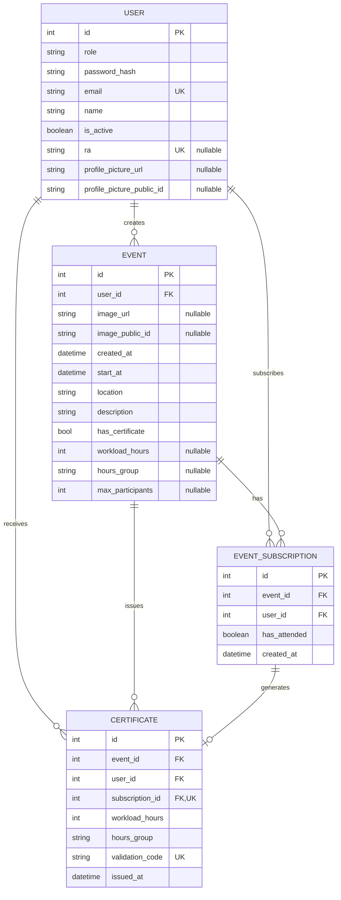

# ERD Proposal

This document proposes the database structure for `User`, `Event`, `EventSubscription`, and `Certificate`.

## Assumptions

- Keep the current `users` table semantics already present in the codebase.
- Use `events` and `event_subscriptions` as the new table names.
- Store image files on Cloudinary, not in the database.
- Keep, for each image, the Cloudinary link (to show it) and its `public_id` (to delete it from Cloudinary when it is replaced, removed, or its event or user is deleted). All four columns are nullable.
- Keep `users.ra` nullable, but only valid for students.
- Prevent duplicate event subscriptions with a unique constraint on `(event_id, user_id)`.
- An event defines a single certificate (`workload_hours` and `hours_group`); each subscribed student receives at most one issued copy of it in `certificates`.

## Mermaid ERD

## Tables

### `users`

| Column | Type | Constraints |
| --- | --- | --- |
| `id` | `int` | primary key |
| `role` | `str` | not null, expected values: `admin`, `student`, `professor` |
| `password_hash` | `str` | not null |
| `email` | `str` | not null, unique |
| `name` | `str` | not null |
| `is_active` | `bool` | not null, default `true` |
| `ra` | `str` | nullable, unique |
| `profile_picture_url` | `str` | nullable, Cloudinary link |
| `profile_picture_public_id` | `str` | nullable, Cloudinary id used to delete the image |

Recommended rule:

- `ra` should only be filled when `role = 'student'`.

### `events`

| Column | Type | Constraints |
| --- | --- | --- |
| `id` | `int` | primary key |
| `user_id` | `int` | not null, foreign key -> `users.id` |
| `image_url` | `str` | nullable, Cloudinary link |
| `image_public_id` | `str` | nullable, Cloudinary id used to delete the image |
| `created_at` | `datetime` | not null |
| `start_at` | `datetime` | not null |
| `location` | `str` | not null |
| `description` | `str` | not null |
| `has_certificate` | `bool` | not null, default `false` |
| `workload_hours` | `int` | nullable, greater than 0; certificate workload in hours |
| `hours_group` | `str` | nullable, one of `group_1`, `group_2`, `group_3` |
| `max_participants` | `int` | nullable, greater than 0; null means no participant limit |

Meaning:

- Each event is created by one user.
- One user can create many events.
- `workload_hours` and `hours_group` are required when `has_certificate` is true and must be null otherwise.
- When `max_participants` is set, subscriptions are refused once the event reaches it.

### `event_subscriptions`

| Column | Type | Constraints |
| --- | --- | --- |
| `id` | `int` | primary key |
| `event_id` | `int` | not null, foreign key -> `events.id` |
| `user_id` | `int` | not null, foreign key -> `users.id` |
| `has_attended` | `bool` | not null, default `false` |
| `created_at` | `datetime` | not null |

Meaning:

- This table represents the many-to-many relationship between users and events.
- One user can subscribe to many events.
- One event can have many subscribed users.

Recommended rule:

- Add a unique constraint on (`event_id`, `user_id`) to prevent duplicate subscriptions.

### `certificates`

| Column | Type | Constraints |
| --- | --- | --- |
| `id` | `int` | primary key |
| `event_id` | `int` | not null, foreign key -> `events.id`, indexed |
| `user_id` | `int` | not null, foreign key -> `users.id`, indexed |
| `subscription_id` | `int` | not null, unique, foreign key -> `event_subscriptions.id` |
| `workload_hours` | `int` | not null, greater than 0; copied from the event when issued |
| `hours_group` | `str` | not null, one of `group_1`, `group_2`, `group_3`; copied from the event when issued |
| `validation_code` | `str` | not null, unique; UUID used to check that a certificate is authentic |
| `issued_at` | `datetime` | not null |

Meaning:

- Each row is the event's certificate issued to one subscribed student.
- One student can have many certificates, one per event at most: unique constraint on (`event_id`, `user_id`).
- A certificate only exists for a subscription, and a subscription generates at most one certificate.
- `workload_hours` and `hours_group` are a snapshot: editing the event later does not change certificates already issued. Student data (name, RA) is read from `users`.

## Relationship Summary

- `users.id` 1:N `events.user_id`
- `users.id` 1:N `event_subscriptions.user_id`
- `events.id` 1:N `event_subscriptions.event_id`
- `users` N:M `events` through `event_subscriptions`
- `users.id` 1:N `certificates.user_id`
- `events.id` 1:N `certificates.event_id`
- `event_subscriptions.id` 1:0..1 `certificates.subscription_id`
